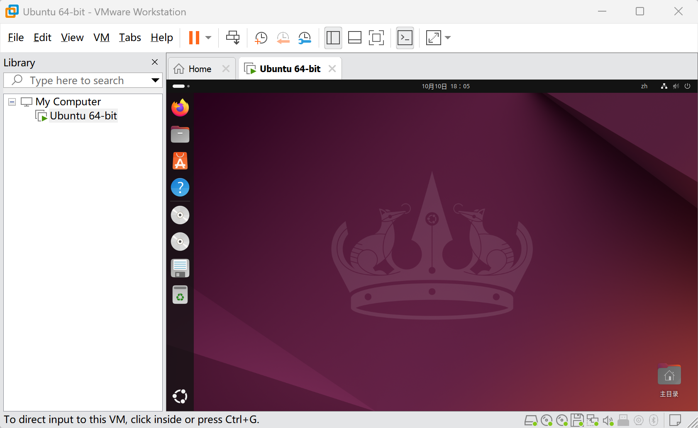

# task1
## ans

### q1 上述安装完成后的Ubuntu桌面截图一张

### q2 了解一下什么是Linux发行版，写一下你对不同发行版的理解
1. linux发行版是包含linux内核和一些用户空间软件的操作系统，其中linux内核负责内存管理、进程调度、文件系统等底层功能。
2. 不同的发行版是不同的团队针对不同的应用场景设计的，采用不同的包管理方式、稳定性策略、默认配置等，具有不同的特点。

### q3 了解虚拟机的三种网络连接方式（NAT，桥接，仅主机），谈谈他们的区别

NAT:网络地址转换，虚拟机通过宿主机转换地址后访问外部网络。
桥接：虚拟机的虚拟网卡直接“桥接”在宿主机网卡上，在外界看来是独立的物理机。
仅主机：虚拟机只通过虚拟网卡和宿主机通信，不连接外部网络。

区别：NAT和桥接可以访问外网，仅主机不行。仅主机方式的虚拟机不能被外部访问，桥接可以，NAT要经过端口转发。