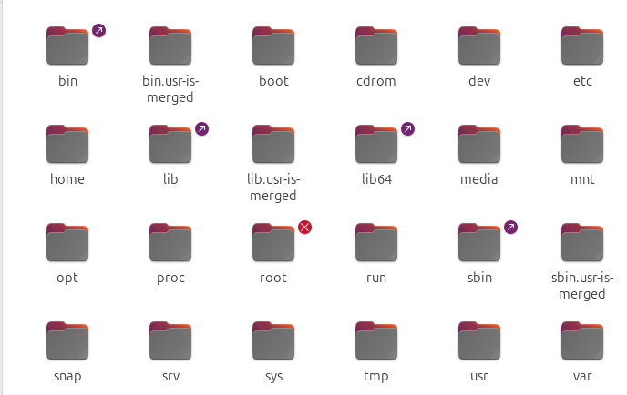
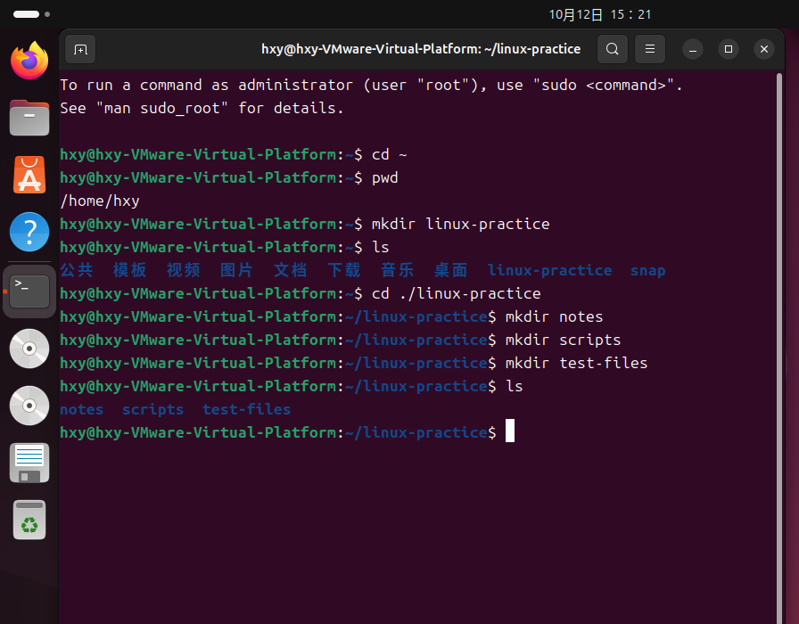
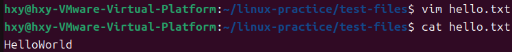
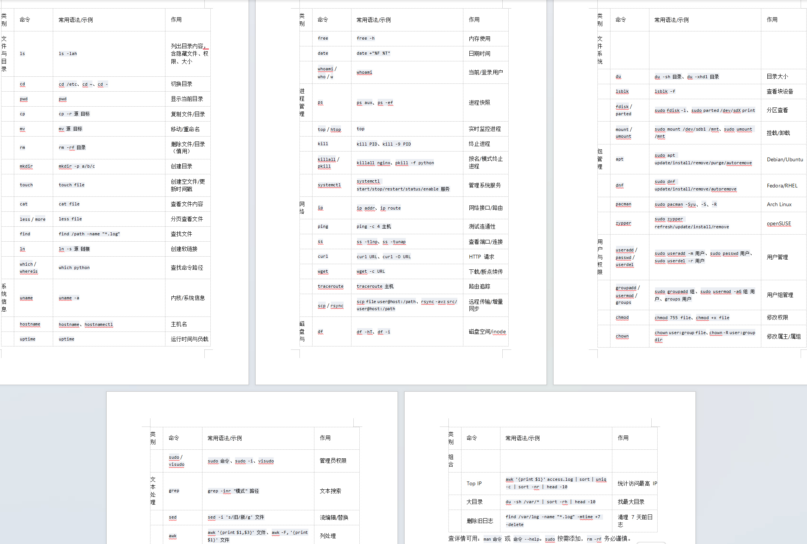

# task2
## ans
- ##### 了解Linux的目录结构，简单写写这些文件夹的作用。
linux所有的文件都挂载在一个叫`/`的根目录下，形成树状的目录结构。

bin里面放着大多数可运行程序；boot里面是启动程序；dev用来放设备，linux系统里设备也被抽象成文件；etc放的配置文件；home是用户家目录；lib放的共享库和内核模块；media是u盘之类的移动设备自动挂载的目录；mnt是临时的挂载点；opt是可选的第三方软件；proc放的进程和内核信息；root是管理员家目录；sbin放的系统管理命令；sys放的设备和内核对象；usr放的用户空间程序和资源。

- ##### 在你的home目录中，运用之前学过的指令，创建如下文件结构并截图：

- ##### 在test-files/文件夹里创建一个叫hello.txt的文本文件，运用指令向其中写入“HelloWorld”，并利用指令查看文件内容，截图。

- ##### Linux指令复杂多样，上边的指令基本只局限于对文件的操控。你需要自行查找还有什么可用的指令，它们的语法结构是什么？可以做成一个速查表方便以后使用。

