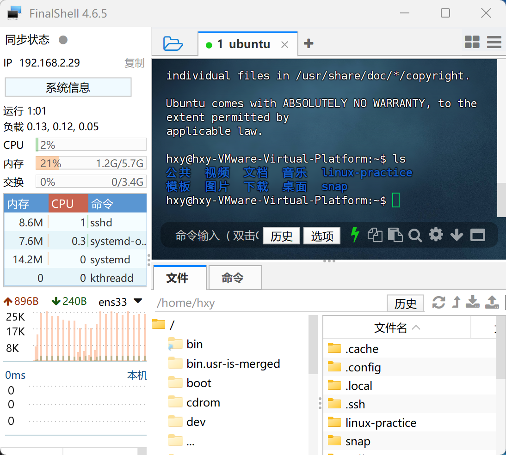

# task4
## ans

- ##### 进一步学习，了解IP地址和端口，写写你的理解
ip地址是机器在网络中的地址，可以通过ip地址找到网络中的其他机器。
端口是应用程序在机器中的地址，不同的应用使用不同的端口与外界通信。

- ##### 把完成配置的FinalShell界面截图并上传，谈谈远程连接可以带来什么方便之处

可以远程控制服务器，文件传输更方便，复制粘贴更方便，不用在虚拟机界面操作，更适合自动化和批量运维。