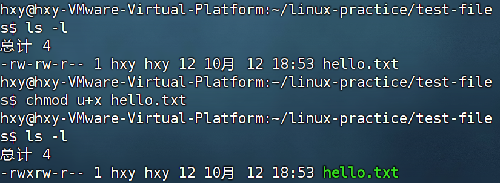

# task5
## ans

- ##### 学习什么是root用户，什么是用户组，该怎样配置新的用户和用户组？

root用户：拥有机器的最高权限，可以读写任何文件，还可以修改整个系统。
用户组：一组用户的集合，用来批量授权。
###### 配置用户：
sudo useradd 用户名//添加新用户
sudo usermod -aG 组名 用户名  //加入新的组
sudo userdel -r 用户名//删除用户及家目录
###### 配置用户组：
sudo groupadd 组名//添加新组
sudo groupdel 组名    //删除组

- ##### 既然root这么强大，我能不能一直开着root呢？会有什么危害吗？谈谈你的看法

不能。首先是误操作风险很大，可能一不小心就把重要的系统文件删了。安全风险也大，如果root权限泄露，服务器可能会被破坏。应该遵守最小权限原则，只提供完成任务所需的最小权限。

- ##### 自己学习chmod命令，尝试修改一个文件的权限，把你输入的命令截图保存

- ##### 天天打rwx还是太吃操作了，有什么简单又强势的方法来简化呢？有的兄弟有的，去学习怎么用数字简化权限表述吧。
r=4 w=2 x=1;表示权限时，可以把权限对应的数字加起来，这个数字就能代表权限。比如7=rwx，6=rw-。